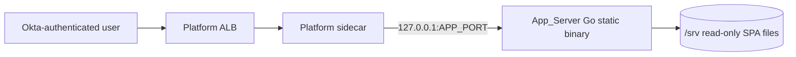
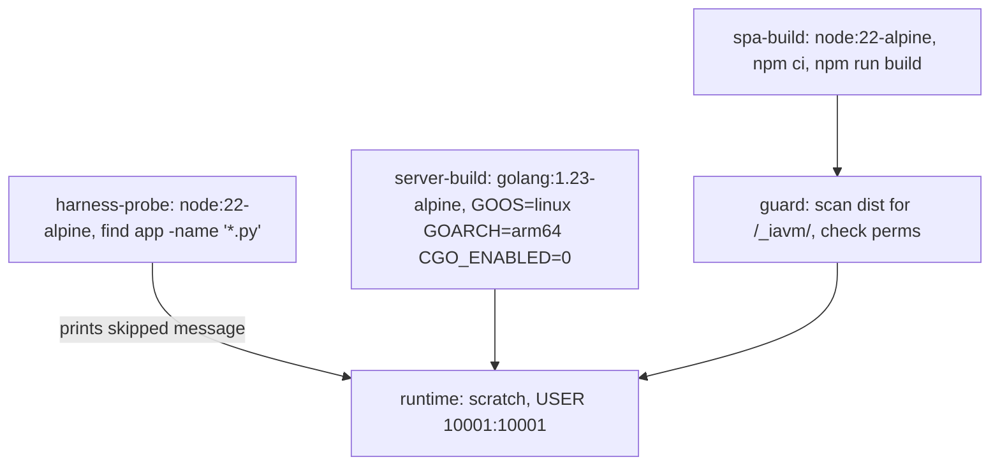
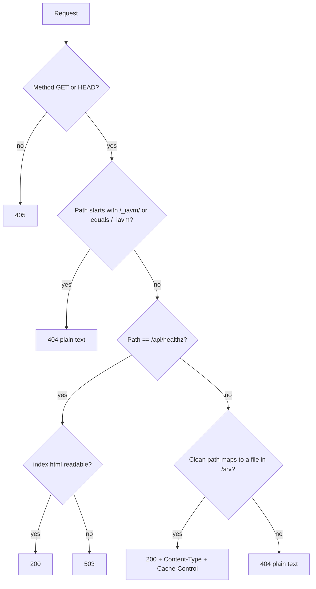

# Design Document

## Overview

This design packages Dt3rmind as an ARM64 container image that meets the seven-point contract of the Internal App Vending Machine (see `docs/early-adopter-onboarding 1.md`). The image serves the prebuilt Vite + React SPA from a small static file server and nothing else.

Key decisions:

| Decision | Choice | Rationale |
|---|---|---|
| App_Server | A purpose-built static server in Go (`server/`), compiled to a static `linux/arm64` binary | The runtime image must contain no Node and no Python (Requirements 10.7, 13.7), no `node_modules`, and no shell. A single static binary can validate `APP_PORT`, bind to loopback, drain on SIGTERM, and enforce routing and cache rules exactly as specified. Stock servers (nginx, Caddy) need a shell wrapper or templating to validate `APP_PORT` and cannot express the readiness rule in 4.4 cleanly. |
| Runtime base | `scratch` | Smallest attack surface. `scratch` has no OS, so there is nothing to publish an arm64 manifest for beyond the build stages (7.5). The binary is the container's PID 1 and receives SIGTERM directly (6.5). |
| Build base images | `node:22-alpine` and `golang:1.23-alpine`, both of which publish `linux/arm64` manifests | Requirement 7.5. |
| SPA routing | No SPA fallback. Unknown paths return 404 | The SPA uses `HashRouter`, so deep links are fragments and never reach the server. Requirement 9.5 forbids returning `index.html` for unmatched paths. |
| Frontend served | The SPA built from `src/` by `npm run build` | Requirement 14.1. |
| `frontend-dist/` | **Excluded** (see Design Decisions) | Requirement 14.2. |
| Python harness | **Conditional**; default image is SPA-only (see Design Decisions) | Requirement 10. |
| Backend wake handling | A new `src/lib/apiFetch.ts` wrapper, unused by the SPA until a backend call is added | Requirement 11. The SPA makes no backend calls today. |

### Design Decisions

#### Decision 1: `frontend-dist/` is excluded from the image (Requirements 14.2, 13.1)

Findings:
- `frontend-dist/` holds a compiled Vite bundle (`index.html`, hashed `index-*.js` and `index-*.css`, `favicon.svg`, `icons.svg`).
- `docs/spec/section-architecture.md` (line 66-67) describes it as the build output of a separate React frontend (`useRunStream`, `ConvergenceView`, `HumanVsAiView`, and similar components) that builds to `../frontend-dist`. That text states the Python `server.py` auto-mounts it.
- The source for that frontend is not in the repository, and neither is `server.py`. The root `package.json` and `vite.config.ts` build only `src/` into `dist/`.
- The bundle is a client for the harness's SSE agent-comparison API. Without the harness it has no backend to call.

Decision: exclude `frontend-dist/` from the Build_Context via `.dockerignore` and from the image filesystem. The image serves only the SPA built from `src/`. If the maintainer later designates `frontend-dist/` (Requirement 14.3), the Dockerfile's `COPY --from=spa-build /app/dist` line is replaced by a copy of `frontend-dist/`, preceded by a check that `frontend-dist/index.html` exists (14.4). That variant is not implemented now.

#### Decision 2: The Python harness is conditional (Requirement 10)

Findings:
- `app/` contains only `__pycache__/*.pyc` (CPython 3.13). No `.py` source is in the working tree or git. `.pyc` files are not a supportable deliverable, so they are never shipped (10.1).
- `data/sales.db` and `data/sales.csv` are only useful to the harness (10.2).
- The SPA does not import the harness.

Decision: the default build is SPA-only.
1. A `harness-probe` Dockerfile stage runs `find app -name '*.py'`. When it finds none, it prints `Harness skipped: no .py sources in build context` to standard output and exits 0 (10.8).
2. The Runtime_Stage copies only the SPA output and the server binary. It has no Python and no `data/` (10.2, 10.7).
3. When `.py` sources exist, `scripts/build.sh` selects `Dockerfile.harness` instead. That file is a documented extension, not created now. It would add a `python:3.13-slim` stage (arm64 manifest published), copy the `.py` sources and `data/` (10.3), and run the harness behind the Go server as a reverse proxy for `/api/` (10.4). The harness would read `LLM_PROVIDER`, accept only `bedrock` or `mock`, and exit non-zero with a message to stderr naming the variable and the accepted values otherwise (10.5, 10.6). The harness would also name any missing credential without printing its value (13.8, 12.2). Because no harness source exists, these behaviors are specified here but not built or tested in this feature.

## Architecture



The sidecar shares the task's network namespace, so loopback binding exposes the server only to it (Requirement 2).

### Image build (multi-stage)



Build steps in order:
1. **spa-build**: copy `package.json` and `package-lock.json`, run `npm ci` (fails on a missing or mismatched lock, 13.5, 13.6), copy `src/`, `content/`, `index.html`, `tsconfig*.json`, `vite.config.ts`, and run `npm run build`. A non-zero exit fails the build (9.7, 14.5). `content/levels/*.json` is imported by `src/` and therefore bundled (9.8).
2. **guard** (same stage family, `RUN` after build): fails the build with the offending paths named if any file under `dist/` has a URL path beginning `/_iavm/`, or if any file in `dist/` contains the string `/_iavm/` (5.3 to 5.5). It also runs `find dist ! -perm -o=r` and fails naming unreadable files (3.6), and checks `dist/index.html` exists.
3. **server-build**: `go build -trimpath -ldflags="-s -w"` of `server/`, with `GOARCH=arm64` set explicitly so the result is arm64 regardless of host.
4. **runtime**: `FROM scratch`, `COPY --chown=10001:10001`-free copy as root-owned files with mode `0444` files and `0555` directories (readable, not writable by 10001, 3.3 to 3.5), then `USER 10001:10001` as the last instruction (3.1). `ENTRYPOINT ["/server"]` in exec form, so the server is PID 1.

The Dockerfile contains the comment `# Recommended APP_PORT: 8080` and no literal port in `ENTRYPOINT`, `CMD`, `EXPOSE`, or server config (1.3, 1.5). The build is invoked with `docker buildx build --platform linux/arm64 -t dt3rmind:release --load .`, which is the command in the README (7.6). Because a failed build produces no image, no release tag exists after failure (7.2).

### Request lifecycle



The server never falls back to `index.html` for unmatched paths, including paths under `/api/` (9.5).

## Components and Interfaces

### 1. `server/main.go` (App_Server)

Pure functions (unit and property tested):

```go
// ParsePort accepts exactly the decimal strings "1025".."65535" (no sign, space, dot, or leading zeros beyond the digits' value).
func ParsePort(s string) (int, error)

// ListenAddr returns "127.0.0.1:<port>". It is the only address the server ever binds.
func ListenAddr(port int) string

// IsReserved reports whether a URL path is "/_iavm" or begins with "/_iavm/".
func IsReserved(urlPath string) bool

// CacheControl returns the Cache-Control value for a served file path (relative, slash-separated).
func CacheControl(rel string) string

// ContentType returns the MIME type for a file by extension.
func ContentType(rel string) string

// RedactedLogLine formats a request log entry from method, path, status and duration only.
func RedactedLogLine(method, path string, status int, d time.Duration) string
```

Handler and lifecycle:

```go
// NewHandler returns the http.Handler serving root (an fs.FS), applying the lifecycle above.
func NewHandler(root fs.FS) http.Handler

// main: ParsePort(os.Getenv("APP_PORT")) -> verify index.html readable -> net.Listen("tcp4", ListenAddr(port))
// -> serve -> on SIGTERM call srv.Shutdown(20s ctx) -> exit 0 if drained, 1 on timeout.
func main()
```

Behavior details:
- **Startup order** (1.1, 1.2, 2.4, 4.2, 4.3): parse `APP_PORT`; on failure print `APP_PORT must be a decimal integer from 1025 to 65535` to stderr and `os.Exit(2)` before any `net.Listen`. Then open `index.html`; on failure print the path to stderr and exit 1 before listening. Then `net.Listen("tcp4", "127.0.0.1:<port>")`; on error print `bind failed: ...` and exit 1 with no fallback address. A listener opens only after the file check, so no connection is accepted before the files are loaded. Startup completes in milliseconds, well inside the 10 s limit (8.4).
- **Health** (4.1, 4.4, 4.5): `/api/healthz` opens and reads one byte of `index.html` on every request and returns 200 or 503 accordingly. It needs no authentication and writes nothing.
- **Reserved prefix** (5.1, 5.2): checked before every other route. No handler is registered under `/_iavm/`.
- **Static files** (9.1 to 9.6): `path.Clean` the URL path, reject any `..`, map `/` to `index.html`, open from the `fs.FS`. Content types: `.html` `text/html; charset=utf-8`, `.js` `text/javascript`, `.css` `text/css`, `.svg` `image/svg+xml`, `.json` `application/json`, otherwise `application/octet-stream`.
- **Cache rules** (9.3, 9.4, 9.6): a file under `assets/` whose name contains a content hash (`-` followed by 8 or more `[A-Za-z0-9_]` characters before the extension, Vite's default) gets `public, max-age=31536000, immutable`. `index.html` and `/` get `no-cache`. Other files get `no-cache`. 404 responses never carry `immutable`.
- **Read-only methods only** (8.1, 8.6): the handler accepts GET and HEAD and returns 405 for everything else, so the server has no code path that stores learner data. The server writes nothing to disk; logs go to stdout.
- **Graceful shutdown** (6.1 to 6.4): `signal.NotifyContext` on `SIGTERM` and `SIGINT`. On signal, `srv.Shutdown(ctx)` closes the listener immediately, so new connections are refused, and waits for in-flight requests up to 20 s. Exit code 0 when `Shutdown` returns nil, 1 when the context deadline is exceeded (remaining connections are closed by `srv.Close()`).
- **Identity headers** (12.1, 12.3): the server has no authentication, session or password code. The access log is built by `RedactedLogLine`, which takes no header arguments, so `x-amzn-oidc-identity` and `x-amzn-oidc-data` values cannot reach log output.
- **No other listeners** (1.4): the server opens exactly one listener and starts no pprof or metrics port.

### 2. `src/lib/apiFetch.ts` (API_Fetch_Wrapper)

```ts
export async function apiFetch(
  path: string,
  options?: RequestInit,
  deps?: { fetch?: typeof fetch; reload?: () => void }
): Promise<Response | null>;
```

Behavior:
1. Call `fetch(path, options)`. If it rejects, the rejection propagates untouched and `reload` is not called (11.6).
2. If `res.status !== 503`, return `res` (11.4).
3. For 503, read `res.clone().json()` in a try block. If parsing fails, return `res` with its body unread (11.5). If the parsed value is an object with `status === "waking"`, call `reload()` once and return `null` (11.2). Otherwise return `res` (11.3).

`deps` default to `globalThis.fetch` and `() => location.reload()`, and exist so tests can observe calls. Requirement 11.1 is enforced by a test that scans `src/` and fails if any file other than `apiFetch.ts` calls `fetch(` directly. The SPA makes no backend calls today, so the wrapper is added and tested but has no callers.

### 3. Build and verification tooling

- `Dockerfile`: the stages above.
- `.dockerignore`: `.env`, `.env.*`, `.git`, `node_modules`, `dist`, `frontend-dist`, `docs`, `tests`, `*.tsbuildinfo`, `**/__pycache__`, `**/*.pyc`, `data` (13.1, 10.1, 10.2). `app/` is included only so `harness-probe` can look for `.py` files; no later stage copies it.
- `scripts/build.sh`: runs the `docker buildx build` command and chooses `Dockerfile.harness` only if `.py` files exist and that file exists.
- `scripts/verify-image.sh` (15.1 to 15.8): builds the image, asserts `docker image inspect` reports `arm64`/`linux`, runs it with `-e APP_PORT=8080` and `-p 127.0.0.1:8080:8080`, polls `/api/healthz` once per second for 60 s, asserts `/` is 200 and `/_iavm/anything` is 404, asserts PID 1 runs as UID 10001 (reads `/proc/1/status` through the Go binary's own test hook or by `docker top`), sends `docker kill --signal=SIGTERM`, and asserts exit status 0 within 25 s. Every failure path prints the failing step, removes the container, and exits non-zero. Success removes the container, prints a success line, and exits 0.
- `README.md` section "For the Platform team": APP_PORT `8080`, health path `/api/healthz`, separate statements for no database, nothing persisted on local disk, and no role or group information needed, the build command, and the five "Tell us early" answers (store data: does not apply; existing system: does not apply; roles: does not apply; one-minute wake: does not apply, since the SPA is static and usable after the wake page; heavy concurrent use: does not apply for the static server, with a one-sentence reason each) (16.1 to 16.5).

## Data Models

The application has no database and persists no data (8.1, 8.6). The relevant structures are configuration and build artifacts.

```go
// Config is derived once at startup from the environment.
type Config struct {
    Port int    // from APP_PORT, 1025..65535
    Root string // "/srv", baked into the image, read-only
}
```

| Item | Source | Constraint |
|---|---|---|
| `APP_PORT` | Environment, supplied at container start | Decimal integer 1025 to 65535, no sign, space, or decimal point |
| Served tree | `/srv` in the image: `index.html`, `assets/*`, `favicon.svg` and similar from `dist/` | Files `0444`, directories `0555`, owned by root |
| Waking response (client side) | Platform | `HTTP 503`, JSON `{"status": "waking"}` |
| Level packets | `content/levels/*.json` (31 files) | Each level identifier appears in the served JS bundle |
| Learner progress | Browser `localStorage` | Never sent to the server |

Image metadata: `Architecture=arm64`, `Os=linux`, `User=10001:10001`, no `Env` entries that carry secrets, no `ARG`-sourced secrets (13.4).

## Correctness Properties

*A property is a characteristic or behavior that should hold true across all valid executions of a system-essentially, a formal statement about what the system should do. Properties serve as the bridge between human-readable specifications and machine-verifiable correctness guarantees.*

Redundancy review merged these criteria: port acceptance (1.1, 2.1), reserved-prefix routing (5.1, 5.2), unmatched and missing-asset handling (9.5, 9.6), provider validation (10.5, 10.6), and wrapper pass-through cases (11.3 to 11.6). Property 11 concerns the conditional harness.

### Property 1: Valid port round trip and loopback address

For any integer `p` from 1025 to 65535, `ParsePort(decimal(p))` returns `p`, and `ListenAddr(p)` equals `"127.0.0.1:" + decimal(p)`.

**Validates: Requirements 1.1, 2.1**

### Property 2: Invalid port rejection

For any string that is not the canonical decimal form of an integer from 1025 to 65535 (including the empty string, signed values, values with decimal points or whitespace, non-digit characters, and integers outside the range), `ParsePort` returns an error whose message contains `APP_PORT` and the range `1025` to `65535`.

**Validates: Requirements 1.2**

### Property 3: Health status tracks file readability

For any sequence of states of `index.html` (readable or unreadable), a request to `/api/healthz` after each state change returns 200 exactly when the file is readable and a non-200 status otherwise, so health recovers on the first request after the file becomes readable again.

**Validates: Requirements 4.4**

### Property 4: Reserved prefix is never served

For any HTTP method and any suffix string `s`, a request whose path is `/_iavm` or `/_iavm/` + `s` receives HTTP 404, and the body is not the content of `index.html`.

**Validates: Requirements 5.1, 5.2**

### Property 5: Existing files are served with correct content type

For any file in a generated served tree whose path is not reserved, a GET for its URL path returns 200, a body equal to the file's bytes, and a `Content-Type` that matches the file's extension. Two handlers built over identical trees return identical status, headers and bodies for the same request.

**Validates: Requirements 9.2, 8.7**

### Property 6: Hashed assets are immutable

For any file name under `assets/` that contains a content hash, `CacheControl` returns a value with `max-age` of at least 31536000 and the `immutable` directive, and a GET for that file carries that header.

**Validates: Requirements 9.3**

### Property 7: Unmatched paths return 404 without fallback or immutability

For any URL path that is not reserved, not `/api/healthz`, and does not match a file in the served tree (including paths under `/assets/` and `/api/`), the server responds 404, the body is not the content of `index.html`, and `Cache-Control` does not contain `immutable`.

**Validates: Requirements 9.5, 9.6**

### Property 8: Waking responses reload exactly once

For any JSON object body containing `"status": "waking"` (with arbitrary additional fields) returned with HTTP 503, `apiFetch` calls `reload` exactly once and returns `null`.

**Validates: Requirements 11.2**

### Property 9: Non-waking responses pass through unchanged

For any response that is not a waking 503 (any status other than 503, or a 503 whose body is valid JSON without `"status": "waking"`, or a 503 whose body is not valid JSON), `apiFetch` returns that response, does not call `reload`, and the body remains readable by the caller. For any error thrown by the underlying `fetch`, `apiFetch` rethrows the same error without calling `reload`.

**Validates: Requirements 11.3, 11.4, 11.5, 11.6**

### Property 10: Log lines never contain identity header values

For any request with arbitrary values in `x-amzn-oidc-identity` and `x-amzn-oidc-data`, the log line the server writes does not contain either value as a substring, provided the value is not also part of the method or path. Generated values use a unique marker so the check is exact.

**Validates: Requirements 12.3**

### Property 11: Provider setting validation (conditional on harness)

For any string `v`, the harness provider validator accepts `v` exactly when `v` is `bedrock` or `mock`, and rejects every other value, including the empty string, with an error naming the variable and listing both accepted values. This property is implemented only if harness sources are added.

**Validates: Requirements 10.5, 10.6**

## Error Handling

| Condition | Behavior | Requirement |
|---|---|---|
| `APP_PORT` unset or invalid | Message naming `APP_PORT` and range on stderr, no socket opened, exit 2 | 1.2 |
| Port in use / bind fails | `bind failed` on stderr, exit 1, no other address tried | 2.4 |
| `index.html` missing or unreadable at start | Path on stderr, exit 1, no listener | 4.3 |
| `index.html` becomes unreadable later | `/api/healthz` returns 503, other paths follow normal lookup | 4.4 |
| Request under `/_iavm/` | 404 | 5.2 |
| Unknown path or asset | 404, no `immutable` | 9.5, 9.6 |
| Non GET/HEAD method | 405 | 8.6 |
| Path traversal attempt (`..`) | 404 | 9.5 |
| SIGTERM, drain finishes within 20 s | Exit 0 | 6.2 |
| SIGTERM, requests remain after 20 s | Remaining connections closed, exit 1 | 6.3 |
| Build: `npm ci` lock error, `npm run build` failure, `/_iavm/` reference, unreadable file, missing `index.html` | Build fails non-zero with the step and offending path, no image tagged | 5.5, 3.6, 7.2, 9.7, 13.6, 14.4, 14.5 |
| No `.py` harness sources | Build succeeds, prints skipped message | 10.8 |
| Verification script step fails | Prints failing step, removes container, exits non-zero | 15.5, 15.7 |
| Fetch wrapper network error | Propagated unchanged | 11.6 |

## Testing Strategy

PBT applies to the pure logic: port parsing, routing, cache policy, file serving over generated trees, log formatting, and the fetch wrapper. It does not apply to the Dockerfile, image metadata, permissions, signal handling against a real container, or the verification script. Those use smoke and integration checks.

### Property-based tests

- **Libraries**: `pgregory.net/rapid` for Go (`server/*_test.go`) and `fast-check` for TypeScript under Vitest (`tests/apiFetch.property.test.ts`). `fast-check` is added as a dev dependency, which changes `package.json` and `package-lock.json`.
- Each property in the Correctness Properties section is implemented by exactly one property-based test, configured to run at least 100 iterations (`rapid.Check` with `-rapid.checks=100`, `fc.assert(..., { numRuns: 100 })`).
- Each test carries a comment tag in the form `Feature: containerize-application, Property N: <property text>`.
- Go tests use `testing/fstest.MapFS` as the served tree and `httptest` for requests, so no real sockets or disk are involved. Property 3 uses a wrapper `fs.FS` whose readability can be toggled.
- Property 11 is written only if harness sources appear.

### Unit and example tests

- `ParsePort` edge cases: `"0001025"`, `"+8080"`, `"8080 "`, `"65536"`, `"1024"`.
- `GET /` returns 200, `text/html`, `Cache-Control: no-cache` (9.1, 9.4); `/index.html` same.
- Startup: missing `index.html` exits non-zero without listening (4.3); occupied port exits non-zero (2.4).
- Graceful shutdown: start the server in-process with a slow handler, trigger shutdown, assert the in-flight request completes and new connections are refused (6.1, 6.4); with a request outliving the 20 s deadline (the deadline is injectable for the test) assert exit code 1 (6.3).
- Level packets: a Vitest test enumerates the 31 files in `content/levels/` and asserts each level identifier appears in the built bundle under `dist/assets/` (9.8).
- Fetch wrapper: the five named cases of 11.7, each asserting the return value or error and whether `reload` was called.
- No-bypass test: scan `src/` for `fetch(` outside `apiFetch.ts` (11.1).
- Guard script: run against fixtures with a `/_iavm/` file and with a `/_iavm/` reference and assert non-zero exit and named offenders (5.5).
- Harness probe: with no `.py` files the build prints the skip message and exits 0 (10.8).

### Integration and smoke checks

`scripts/verify-image.sh` covers requirements that need a real container: arm64 metadata (7.3), listening on `APP_PORT` (1.1, 1.4), PID 1 UID 10001 (3.2), `/api/healthz`, `/`, and `/_iavm/anything` (4.1, 5.2, 9.1), SIGTERM exit 0 within 25 s (6.2, 6.5), and 30 s of running without `exec format error` on an ARM64 host (7.4). Additional manual or scripted checks: run with `--read-only` and compare responses (8.5), run with `--cpus=0.5` and confirm the first health check within 10 s (8.4), and write attempts as UID 10001 fail (3.5). Static inspection checks (grep or `docker history` and `docker image inspect`) cover: no literal port in ENTRYPOINT/CMD/config and the 8080 comment (1.3, 1.5), final `USER` (3.1), file modes (3.3, 3.4), `.dockerignore` contents (13.1), no `.env` files or values in any layer (13.2, 13.4), `npm ci` used (13.5), no `node_modules`, no Python, no `.py`, no `.pyc` in the final image (10.1, 10.7, 13.7), no cron (8.3), base images' arm64 manifests (7.5), `frontend-dist/` absent from the image (14.2), and the README handoff content (7.6, 16.1 to 16.5).

### Conditional harness tests

Requirements 10.3, 10.4, 12.2, 12.4, 12.5 and 13.8 apply only if harness sources are added. They are not testable now. They become example tests, plus Property 11, when `Dockerfile.harness` is implemented.
